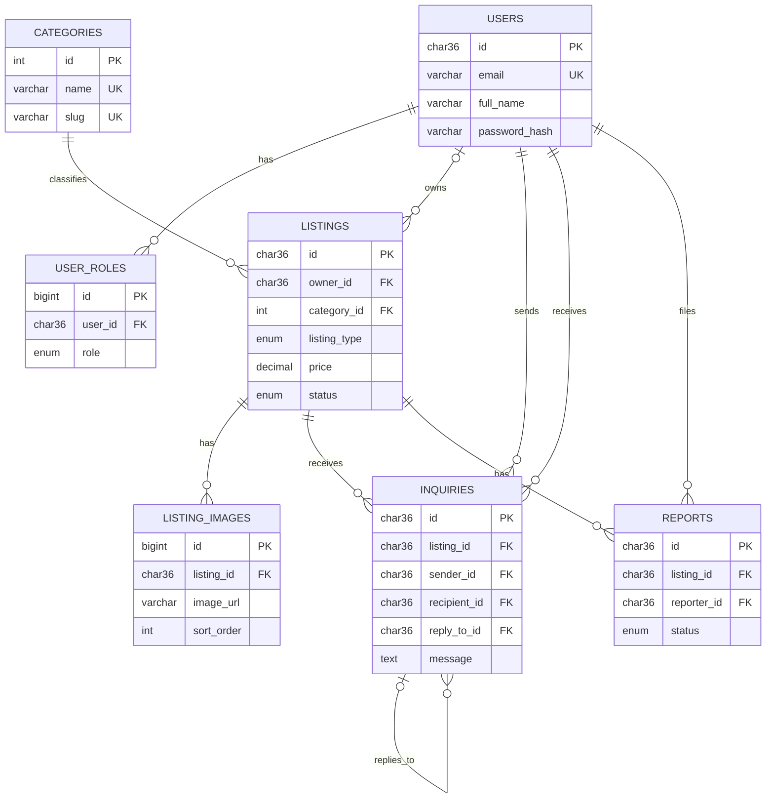

# ReUseHub ER diagram (editable Mermaid source)

Paste/edit this Mermaid block in a Mermaid-compatible editor. It is the separate MySQL presentation model.

## Keys and relationships
- Every `id` is a primary key: it identifies exactly one row. UUID-style IDs use CHAR(36); category/image/role IDs are numeric.
- `user_roles.user_id` references users. `(user_id, role)` is unique, allowing protected role membership without a role field on a user-editable profile.
- `listings.owner_id` references users (nullable only for non-contactable samples); `category_id` references categories.
- `listing_images.listing_id` references listings; `(listing_id, sort_order)` is unique.
- `inquiries.listing_id`, `sender_id`, `recipient_id` reference listing/user/user respectively. `reply_to_id` optionally references a received inquiry.
- `reports.listing_id` and `reporter_id` reference listing/user. Each user can report a particular listing once.
- A user owns many listings; a category classifies many listings; each listing has many possible images/messages/reports.
- Deleting a user cascades to their listings, roles and messages/reports; deleting a listing cascades to its images/messages/reports. Deleting a category with listings is restricted.

## Hosted model difference
Hosted identities are `auth.users`, public details are `profiles`, roles are `user_roles`. The app currently stores one image URL on each listing and files in Cloud storage. The separate MySQL model combines auth/profile teaching fields in `users` and normalizes images into `listing_images`; this is a documented extension, NOT a live multi-image feature.
